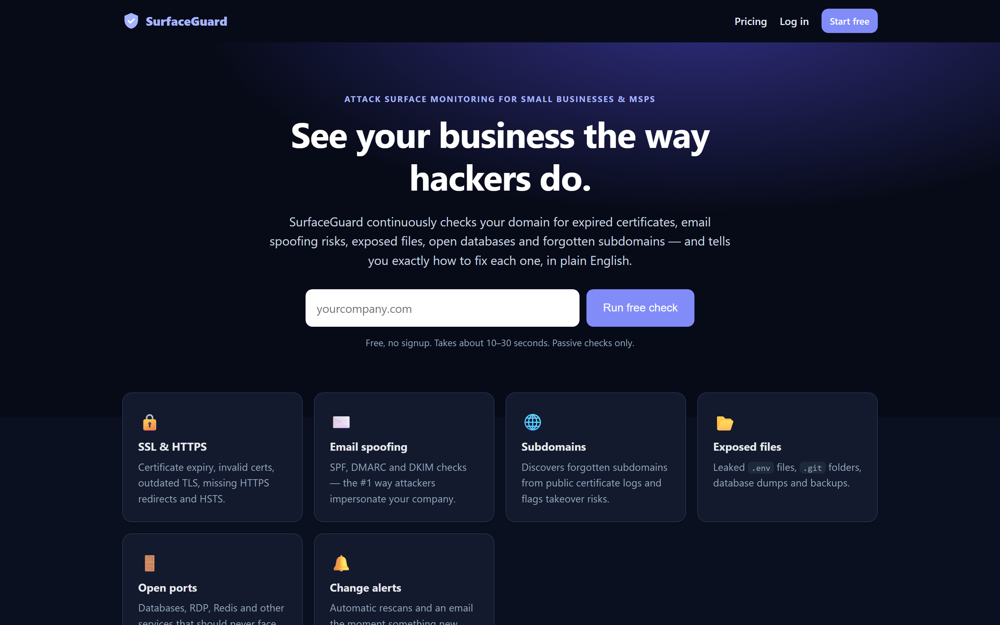
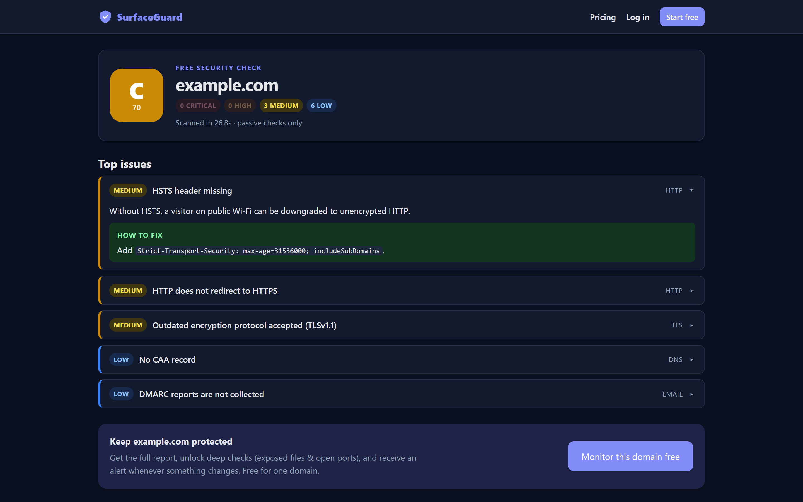

# SurfaceGuard

Attack-surface monitoring SaaS for small businesses and MSPs: see your business the way attackers do.



Enter a domain and SurfaceGuard checks SSL/TLS, email-spoofing protection (SPF/DMARC/DKIM), HTTP security
headers and public subdomains (including takeover risks), then grades it A–F with a plain-English fix for every
issue. After the owner verifies the domain via DNS, it also checks for exposed files (`.env`, `.git`, backups)
and risky open ports. Rescans run automatically and alert on anything new.



| Folder | What it is |
|---|---|
| [`surfaceguard/`](surfaceguard/) | The web app (FastAPI + SQLite, Stripe billing, Fly.io deploy). Start with its [README](surfaceguard/README.md); deploy steps are in [DEPLOY.md](surfaceguard/DEPLOY.md). |
| [`saas-builder/`](saas-builder/) | The Claude skill that captures how this product was built, for reuse on the next SaaS idea. |

## Quick start

```bash
cd surfaceguard
python -m venv .venv
.venv\Scripts\pip install -r requirements.txt
.venv\Scripts\python -m uvicorn app.main:app --port 8000
```

Secrets (Stripe keys, session secret, SMTP) are never committed. Locally the app runs without them (set
`DEMO_BILLING=1` for free plan switching while developing); in production they are set with `fly secrets set`,
and demo billing is never available there.
